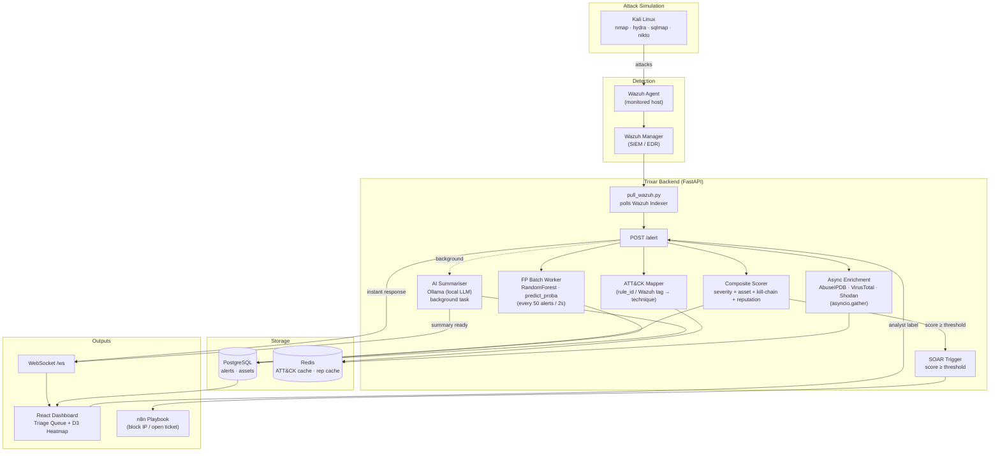

# Trixar — SOC Alert Triage & MITRE ATT&CK Mapper

Trixar ingests security alerts from a SIEM, enriches them with threat intelligence,
maps them to MITRE ATT&CK techniques, scores their priority, explains them in plain
language with a local LLM, and can trigger automated response playbooks — all without
ever blocking the analyst on a slow step.

Built as a hands-on SOC engineering project: Wazuh → FastAPI → PostgreSQL/Redis →
React dashboard → n8n SOAR, running entirely in a self-contained Kali Linux lab.

---

## Why it's built this way

Three architectural rules run through the whole project:

1. **Nothing per-alert ever calls a slow or rate-limited API live.** The ATT&CK
   technique catalog is downloaded once and cached in Redis, refreshed daily by cron.
2. **Enrichment calls run concurrently, not in series.** AbuseIPDB, VirusTotal and
   Shodan are called with `asyncio.gather()`, so three 1-second calls take ~1 second
   total instead of 3.
3. **The score is always instant; the AI summary never blocks it.** A `POST /alert`
   call maps the technique, enriches the IP, computes a composite score, and returns
   — all in well under a second. The LLM explanation and the false-positive model
   run *after* the response, pushed to the browser over WebSocket when ready.

---

## Architecture



**The response path in one line:** `ingest → map (Redis) → enrich (3 APIs at once) →
score → save → respond` — all synchronous and fast. The AI summary, SOAR webhook,
and FP batch scoring happen *after* that response, asynchronously.

---

## Tech stack

| Layer | Technology |
|---|---|
| SIEM / EDR | Wazuh (Indexer, Manager, Dashboard) |
| Backend API | Python, FastAPI, asyncpg, httpx, WebSockets |
| Storage | PostgreSQL (alerts/assets), Redis (ATT&CK cache, reputation cache) |
| ATT&CK data | MITRE ATT&CK STIX bundle, `mitreattack-python`, cached locally |
| Threat intel | AbuseIPDB, VirusTotal, Shodan (called concurrently via `asyncio.gather`) |
| ML | scikit-learn `RandomForestClassifier`, batch `predict_proba` |
| AI summaries | Ollama (local LLM, `llama3.2`), async via background task |
| Dashboard | React + Vite + Tailwind CSS, D3.js heatmap |
| SOAR | n8n (webhook-triggered playbooks) |
| Attack simulation | nmap, Hydra, Nikto, sqlmap against a Kali lab network |

---

## Project layout

```
trixar/
├── app/
│   ├── main.py          # FastAPI app: /alert, /alerts, /stats/techniques, /ws
│   ├── config.py         # env var loading
│   ├── db.py              # asyncpg pool + queries
│   ├── mapper.py           # rule_id -> ATT&CK technique
│   ├── enrich.py            # async AbuseIPDB/VT/Shodan enrichment
│   ├── scoring.py             # composite priority score
│   ├── ai.py                   # Ollama summariser
│   ├── fp_worker.py              # batch false-positive classifier
│   └── ws.py                      # WebSocket broadcast manager
├── scripts/
│   ├── update_attack.py   # downloads + caches ATT&CK STIX bundle (cron, daily)
│   ├── pull_wazuh.py       # polls Wazuh Indexer, forwards to POST /alert
│   ├── train_fp.py           # synthetic FP model (bootstrap)
│   └── train_fp_real.py       # retrains FP model on analyst-labelled alerts
├── dashboard/
│   └── src/
│       ├── App.jsx      # triage queue, labelling buttons, live WebSocket updates
│       └── Heatmap.jsx    # D3 ATT&CK heatmap
├── schema.sql          # PostgreSQL schema (alerts, assets)
└── wazuh-docker/      # official Wazuh single-node Docker Compose
```

---

## Setup

### Prerequisites
- Kali Linux VM, 4+ CPU cores, 8GB+ RAM (more if running Ollama alongside Wazuh)
- Docker, Python 3, Node.js 18+

### 1. Start the stack
```bash
# Wazuh (SIEM)
cd ~/trixar/wazuh-docker/single-node && docker compose up -d

# Postgres, Redis, n8n
docker start trixar-pg trixar-redis trixar-n8n

# Ollama (local LLM)
sudo systemctl start ollama
```

### 2. Start the backend
```bash
cd ~/trixar && source venv/bin/activate
python -m uvicorn app.main:app --reload
```

### 3. Start the dashboard
```bash
cd ~/trixar/dashboard && npm run dev
```
Open **http://localhost:5173**

### 4. Keep the ATT&CK cache fresh (one-time + cron)
```bash
python scripts/update_attack.py
# cron: 0 3 * * * cd ~/trixar && .venv/bin/python scripts/update_attack.py
```

---

## How an alert flows through the system

1. **Ingest** — `pull_wazuh.py` polls the Wazuh Indexer for recent alerts and POSTs
   each one to `/alert`.
2. **Map** — the rule ID is looked up in a local override table; if unmapped, Wazuh's
   own MITRE tag is used as a fallback. The technique's name/tactic comes from Redis,
   never a live MITRE API call.
3. **Enrich** — the source IP (if public) is checked against AbuseIPDB, VirusTotal and
   Shodan concurrently, with results cached in Redis for 6 hours.
4. **Score** — severity, asset criticality, ATT&CK kill-chain stage, and reputation are
   combined into a single 0–100 priority score, saved immediately.
5. **Respond** — the API returns the score and technique right away.
6. **(Background) Summarise** — a local LLM explains the alert in plain language and
   recommends a first action; pushed to the dashboard over WebSocket when ready.
7. **(Background) FP-score** — the alert is queued for the batch classifier, which
   scores up to 50 alerts at once every 2 seconds.
8. **(Background) SOAR** — if the score crosses a configurable threshold, an n8n
   playbook fires (in this lab: a simulated IP block + ticket).
9. **Feedback** — an analyst marks the alert "confirmed threat" or "false positive" in
   the dashboard; these real labels are used to periodically retrain the FP classifier,
   replacing the synthetic bootstrap data.

---

## Known limitations & honest next steps

- The false-positive model's "alert frequency" feature is currently a placeholder;
  a real per-rule rolling frequency (already queried in `db.rule_frequency`) should
  replace it in the next retrain.
- The D3 heatmap renders only techniques that have fired at least one alert — it is
  not the full ATT&CK Navigator matrix. A worthwhile extension.
- SOAR playbooks only simulate a block; wiring a real firewall/EDR action would need
  a human-approval step and an allow-list, not direct automation.
- The RULE_MAP currently covers a handful of Wazuh rule IDs; extending it toward the
  spec's "map first 20 alert types" goal is ongoing as new rule IDs are observed.

---

## Credits

Built against the MITRE ATT&CK framework (https://attack.mitre.org). Attack
simulation performed only against intentionally vulnerable lab targets
(Metasploitable2, DVWA, OWASP Broken Web Apps) on an isolated host-only network.
